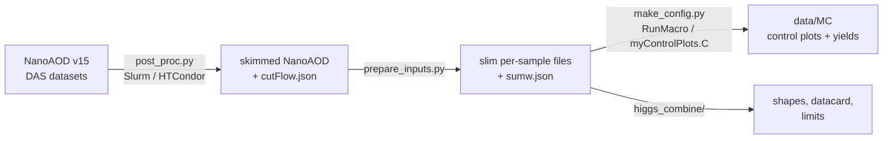

# HZZ 2l2nu NanoAOD skim

This package is a NanoAOD skimmer for the **X/H &rarr; ZZ &rarr; 2&ell;2&nu;** search,
with the **e&mu;** and **single-photon (&gamma;+jets)** control regions. It also
contains the pipeline that turns the skims into **data/MC control plots**. It is
built on the `nanoAOD-tools` `PostProcessor` and lives inside a CMSSW release at

```
$CMSSW_BASE/src/PhysicsTools/NanoAODTools/python/postprocessing/analysis/nanoAOD_skim
```

The 4&ell; and 2&ell;2q code paths are still in the code, but this documentation
covers the 2&ell;2&nu; branches (`HZZ_Analysis_2l2nu_dev`,
`HZZ_Analysis_2l2nu_dev_gammaCR`).

| | |
| --- | --- |
| **Input** | NanoAOD **v15** (the UL re-NanoAOD). A v9 file fails with `Unknown branch Electron_mvaIso_WP90`. |
| **Years** | Run 2 UltraLegacy: 2016preVFP, 2016postVFP, 2017, 2018 |
| **Reference selection** | CMS AN-2016/325 (2&ell;2&nu;) and AN-15-208 (&gamma;+jets), with UL / v15 object IDs |
| **Release** | `CMSSW_14_0_2` (`el8_amd64_gcc12`), run inside `cmssw-el9` on el8 hosts |

## Workflow



| step | runs where | tool | page |
| --- | --- | --- | --- |
| 1. skim NanoAOD | `cmssw-el9` container | `post_proc.py`; at scale with Slurm (Purdue) or HTCondor (lxplus) | [Running the skim](running.md) |
| 2. slim inputs, &Sigma; genEventSumw, data de-duplication | AF host, pixi ROOT | `scripts/analysis/prepare_inputs.py` | [Control plots](control-plots.md) |
| 3. control plots and yields | AF host, pixi ROOT | `plotting/` | [Control plots](control-plots.md) |
| 4. shapes, datacard, limits | ROOT + Combine | `higgs_combine/` | [Output](output.md#downstream-higgs_combine) |

Steps 2&ndash;4 must **not** run in a shell where `cmsenv` or `set_env.sh` was
sourced.

## What the skim does, in one paragraph

Each event goes through the following steps in order:

1. **Preselection:** at least 2 leptons, or for `1g` at least 1 barrel photon.
2. **Golden JSON** (data only).
3. **Trigger:** OR of every list in the year's YAML.
4. **MET noise filters.**
5. **Object selection:** Rochester-corrected muons, MVA-iso WP90 electrons, FSR
   recovery, AK4 PUPPI jets with a recomputed TightLepVeto ID, UParTAK4 b tagging,
   MET-&phi;-corrected PuppiMET.
6. **Region selection:**
    - **ee/&mu;&mu;:** Z&#8321; is the same-flavour tight pair closest to m<sub>Z</sub>,
      with no charge requirement.
    - **e&mu; CR:** exactly one tight e and one tight &mu;.
    - **&gamma; CR:** exactly one tight barrel photon, which plays the role of the Z.
7. **Common to all three regions:** the extra-lepton and soft-muon vetoes, the jet
   and b-tag counts, the VBF tag, Z+MET kinematics and the AN transverse mass.

The skim is deliberately **loose**. The MET, p<sub>T</sub><sup>&ell;&ell;</sup> > 55,
on-Z, b-veto and &Delta;&phi; cuts are applied downstream, in the control-plot
cut files.

## Building these docs

```bash
pip install mkdocs-material        # any Python >= 3.8, no CMSSW needed
mkdocs serve                       # from nanoAOD_skim/, then open http://127.0.0.1:8000
mkdocs build                       # static site in site/
```

!!! note "Source of truth"
    Thresholds and trigger lists live in `config/Input_<year>.yml`, selection logic
    in `src/H4LTools.cc`, and control-region cuts in `plotting/make_config.py`.
    These pages summarise them as of the `HZZ_Analysis_2l2nu_dev_gammaCR` branch.
    If a page and the code disagree, trust the code.

